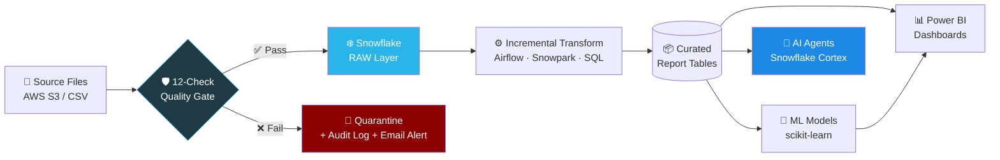

<!-- ================= HEADER ================= -->
<p align="center">
  
</p>

<p align="center">
  <a href="https://git.io/typing-svg">
    
  </a>
</p>

<p align="center">
  <a href="https://www.linkedin.com/in/ayoush-paul-33b7022a4/"></a>
  <a href="https://github.com/Ayoush02"></a>
  
</p>

---

## 👋 About Me

I'm **Ayoush Paul**, a **Data Engineer** who builds the systems that move, check and shape data so businesses can trust their numbers. I work mainly on **Snowflake** with **Python** and **SQL**. I'm currently building **AI agents with Snowflake Cortex**.

My work covers the whole data lifecycle:

- 🏗️ **Engineer**: automated, incremental pipelines with **Airflow, Docker, Snowpark and AWS S3**
- 🛡️ **Validate**: data quality gates that stop bad data before it reaches reporting
- 🤖 **Model**: machine learning that solves real business problems, such as credit risk
- 📊 **Communicate**: **Power BI** dashboards and findings that business leaders can act on
- 🎓 **Teach**: I've designed and delivered hands-on **Snowflake** and **Python for Data Science** training programs

```yaml
current_focus:   "Building AI agents on Snowflake Cortex"
core_platform:   "Snowflake (Snowpark · Cortex AI · RBAC · Data Sharing)"
daily_tools:     ["Python", "SQL", "Airflow", "Docker", "AWS S3", "Power BI"]
mindset:         "Reliable data first, insights second, hype never"
open_to:         "Data Engineering & Analytics Engineering roles · collaborations"
```

---

## 💼 What I Bring to Your Team

<table>
<tr>
<td width="50%" valign="top">

### 🔄 Reliable, Automated Pipelines
I build pipelines that run by themselves on a schedule and process **only new data** (incremental loads). They are containerised, so they behave the same in every environment.

</td>
<td width="50%" valign="top">

### 🛡️ Data You Can Trust
I build **data quality frameworks**: 12 sequential gate checks, automatic quarantine of bad files, full audit logs and email alerts, so problems are caught before anyone sees a wrong number.

</td>
</tr>
<tr>
<td width="50%" valign="top">

### 📈 Business-First Analytics
I start from the business problem: default rates, unsold inventory, dependence on a few vendors. Then I deliver **measurable results** and clear recommendations.

</td>
<td width="50%" valign="top">

### 🎓 Knowledge Multiplier
I've built and taught a **12-day Snowflake curriculum** and a **40-hour Python for Data Science & ML** course, so I can help teams get up to speed quickly.

</td>
</tr>
</table>

---

## 🛠️ Tech Stack

**☁️ Data Platform & Cloud**

<p>
  
  
  
  
  
</p>

**⚙️ Data Engineering & Orchestration**

<p>
  
  
  
  
</p>

**🐍 Programming, Analytics & ML**

<p>
  
  
  
  
  
</p>

**📊 Visualisation & Tools**

<p>
  
  
  
  
  
</p>

---

## 🧭 How I Build Data Systems



---

## 🚀 Featured Projects

| Project | What it does | Impact / Highlights | Stack |
|:--|:--|:--|:--|
| 🛡️ **[Snowpark Data Quality Framework](https://github.com/Ayoush02/snowpark-data-quality-framework)** | Production-grade framework that checks every CSV arriving in S3 before it can load into Snowflake | **12 sequential gate checks** · auto-quarantine · full audit logging · native Snowflake email alerts · configurable for any team | Snowpark Python, AWS S3, Snowflake |
| 💳 **[MSME Credit Risk Scoring](https://github.com/Ayoush02/msme-credit-risk-scoring)** | End-to-end credit scoring for a lender serving 50,000+ small businesses | **AUC-ROC 0.92** · default rate **12.8% → 8.1%** (projected) · review time **4.2 → 2.5 hrs/loan** · flags risk **2 repayment cycles early** | MySQL, Python, scikit-learn, Power BI |
| 📦 **[Vendor Performance Optimization](https://github.com/Ayoush02/Vendor-Performance-Optimization-Through-Profitability-Inventory-Analytics)** | Profitability and inventory analytics across vendors and brands | Analysed **$441M in sales** · found **$2.71M in unsold inventory** · showed **65.7% dependence on the top 10 vendors** · bulk buying cuts unit cost by **72%** | Python, SQL, Power BI |
| ⏱️ **[Daily Sales Pipeline](https://github.com/Ayoush02/daily-sales-pipeline-airflow-snowflake)** | Automated pipeline: load → capture new rows → summarise → check | **Incremental** daily processing · 3 report tables (region, product, day) · containerised | Airflow, Docker, Snowflake |

### 🎓 Training Programs I've Built

| Program | Coverage |
|:--|:--|
| ❄️ **[Snowflake Training Session](https://github.com/Ayoush02/Snowflake-Training-Session)** | 12-day hands-on curriculum: Architecture · RBAC · SQL · Loading & Unloading · Clustering · SCD & Snowpark · Data Quality · **Cortex AI** · Data Sharing · Final Project · MCQ question bank |
| 🐍 **[Python for Data Science & ML](https://github.com/Ayoush02/Python_for_Data_Science_and_ML_Training)** | 40-hour program: Python fundamentals · Functions & error handling · NumPy & Pandas · Statistics · Machine learning (2 parts) |

---

## 📊 GitHub Stats

<p align="center">
  
  
</p>

<p align="center">
  
</p>

<p align="center">
  
</p>

<!-- 🐍 Contribution snake: works after you add the snake.yml workflow (see setup notes) -->
<p align="center">
  
</p>

---

## 🌱 Currently

- 🔭 Building **AI agents with Snowflake Cortex**
- 🧪 Making data quality checks **reusable across teams**
- 📚 Growing my training content for upcoming data engineers
- 🤝 Open to **Data Engineering** roles, freelance pipeline work and collaborations

---

## 🤝 Let's Connect

<p align="center">
  <i>If your team needs reliable pipelines, trustworthy data or someone to help your team learn Snowflake, let's talk.</i>
</p>

<p align="center">
  <a href="https://www.linkedin.com/in/ayoush-paul-33b7022a4/"></a>
</p>

<p align="center">
  
</p>
